# Seguimiento de portafolio COP/USD (renta variable + renta fija)

App en Streamlit para registrar y simular un portafolio: inviertes en COP, compras acciones/ETF en USD
(KO y NKE obligatorias), también CDT/bonos/TES en COP, y todo se mide en COP con la TRM.
Calcula rentabilidad acumulada y **efectiva anual (E.A.)**, total invertido, valor actual y la
distribución renta fija / renta variable / caja.

## Instalación
```bash
python -m venv .venv && source .venv/bin/activate   # Windows: .venv\Scripts\activate
pip install -r requirements.txt
streamlit run app.py
python -m unittest discover -s tests                 # pruebas sin internet
```

## Cómo se usa
**Registro de operaciones** (pestaña 1): eliges instrumento, tipo de operación, fecha y ticker, y escribes
**tu** precio, TRM y comisión. Si dejas el precio o la TRM en 0 se usa el de mercado (yfinance); si dejas la
comisión en 0 se usa el % global de la barra lateral. Tipos: Compra, Venta, Dividendo (fecha de pago,
valor por acción en USD y TRM de ese día), Interés (monto en COP) y Pago de capital. Para CDT/Bono/TES
escribes valor unitario, tasa E.A. y vencimiento (cada título con un nombre distinto).
Puedes eliminar operaciones, exportar/importar CSV y cargar un ejemplo.

**Simulación por pesos / Excel** (pestaña 2): reparte el capital por ponderación o usa las operaciones y la
tabla de dividendos (fecha ex y de pago) de tu Excel.

## Estructura
| Archivo | Clase | Responsabilidad |
|---|---|---|
| `app.py` | – | Archivo principal: carga el Dashboard |
| `portafolio/dashboard.py` | `Dashboard` | Interfaz Streamlit |
| `portafolio/modelos.py` | `Activo`, `Parametros`, `Resultado` | Datos del dominio |
| `portafolio/operacion.py` | `Operacion`, `LibroOperaciones` | Registro y validación de operaciones |
| `portafolio/datos.py` | `ProveedorDatos` | yfinance: precios, dividendos (fecha ex), TRM histórica y TRM actual `COP=X` (caché diaria) |
| `portafolio/importador.py` | `ImportadorExcel` | Lee operaciones y dividendos del Excel |
| `portafolio/motor.py` | `MotorContable` | Fórmulas del Excel para un activo |
| `portafolio/calculadora.py` | `CalculadoraRentabilidad` | Rentabilidad acumulada y E.A. (XIRR) |
| `portafolio/portafolio.py` | `Portafolio` | Orquesta, renta fija, consolida, métricas |
| `portafolio/graficos.py` | `Graficador` | Gráficos Plotly |
| `tests/test_calculos.py` | – | Pruebas unitarias |

## Diagrama UML

```mermaid
classDiagram
    class Activo { +str ticker; +float peso; +bool obligatorio; +str instrumento; +float tasa_ea; +int plazo_dias; +float comision_pct; +bool capitaliza; +es_renta_fija() bool; +tipo() str }
    class Parametros { +float capital_cop; +date fecha_inicio; +date fecha_fin; +float comision_pct; +bool permitir_fracciones; +int rezago_pago_dias }
    class Resultado { +dict libros; +DataFrame consolidado; +dict metricas; +Series pesos_finales; +Series distribucion_tipo; +DataFrame resumen_activos; +DataFrame detalle_operaciones; +DataFrame formato_excel }
    class Operacion { +date fecha; +str tipo; +str ticker; +str instrumento; +float cantidad; +float precio; +float trm; +float comision; +float tasa_ea; +date vencimiento; +bool capitaliza; +date fecha_ex }
    class LibroOperaciones { +agregar(op); +eliminar(i); +activos() list; +transacciones() DataFrame; +dividendos_manuales() dict }
    class ProveedorDatos { +descargar_activo(ticker, inicio, fin) DataFrame; +descargar_trm(inicio, fin) Series; +trm_actual() dict }
    class ImportadorExcel { +leer(archivo) tuple }
    class MotorContable { +float comision_pct; +libro_activo(precio_usd, trm, operaciones, dividendos) DataFrame }
    class CalculadoraRentabilidad { +rentabilidad_acumulada(base, ganancia) float; +anualizar(rent, dias) float; +tasa_efectiva_anual(flujos) float }
    class Portafolio { +simular(transacciones) Resultado }
    class Graficador { +dona_pesos(); +dona_tipo(); +evolucion_total(); +comparativa_activos(); +composicion(); +dividendos() }
    class Dashboard { +ejecutar() }
    LibroOperaciones o-- Operacion
    Portafolio o-- Activo
    Portafolio --> Parametros
    Portafolio --> ProveedorDatos
    Portafolio ..> MotorContable : crea uno por activo
    Portafolio ..> CalculadoraRentabilidad : usa
    Portafolio ..> Resultado : crea
    Graficador ..> Resultado : usa
    Dashboard --> LibroOperaciones
    Dashboard --> Portafolio
    Dashboard --> ImportadorExcel
    Dashboard --> Graficador
    LibroOperaciones ..> Activo : genera
```


## Fórmulas (idénticas al Excel)
- Acciones = Acciones_anterior + Compra − Venta
- Valor COP = Valor USD × TRM del día
- Dividendo COP = Dividendo USD × TRM del día de **pago**, sobre las acciones que se tenían en la fecha ex (o las indicadas a mano)
- Comisión = % de corretaje (0,2 %) × Precio COP × (Compra + Venta), o el valor escrito
- Saldo caja = Saldo_anterior − (Precio COP × Compra) + (Precio COP × Venta) + (Dividendo COP × Acciones) − Comisión
- Renta fija: valor = valor de compra × (1 + E.A.)^(días/365), sin crecer después del vencimiento
- Rentabilidad acumulada = Valor final / Capital − 1 · E.A. = TIR con fechas (XIRR) de los flujos

## Git (rúbrica: varias ramas y varios commits)
```bash
git init && git add . && git commit -m "Estructura inicial del proyecto"
git checkout -b feature/motor-contable   # commits: motor, pruebas
git checkout -b feature/renta-fija main  # commits: renta fija, E.A.
git checkout -b feature/dashboard main   # commits: operaciones manuales, gráficos
git checkout main && git merge feature/motor-contable feature/renta-fija feature/dashboard
```
